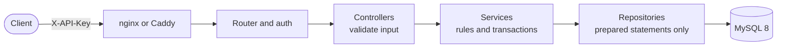
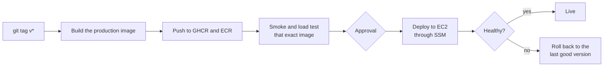

<div align="center">

# PluginXchange

**A reseller marketplace API for software license keys that never sells the same key twice.**

[](https://github.com/AjayMaan13/PluginXchange/actions/workflows/ci.yml)


[Quickstart](#quickstart) · [Try the API](#try-the-api) · [How it works](#how-it-works) · [Proof](#proof-it-never-double-sells) · [Docs](#documentation)

</div>

Vendors list audio plugins and their license keys, resellers buy keys through a JSON API, and support can trace and cancel any order.
It is plain PHP 8.3 and MySQL 8, with no framework, built to show the parts that are easy to get wrong: concurrency, retries, money,
audit trails and releases.

## Highlights

- **Never double-sells.** Orders lock their keys with `SELECT ... FOR UPDATE SKIP LOCKED` inside one transaction. Verified with a C# load
  test: 3,000 parallel orders, 0 duplicate keys.
- **Safe retries.** An `idempotency_key` makes a repeated order return the first one, even when two identical requests arrive at the same instant.
- **Everything is traceable.** Every response carries a request id that appears in the audit log and the server log. One support call
  (`/support/orders/{id}/trace`) explains an order from start to finish.
- **Money is exact.** Integer cents everywhere, with a database integrity check that verifies every total.
- **Bulk catalog import** with per-row validation: 500 products and 10,000 keys in about a second, bad rows reported and the rest imported.
- **Released like a real service.** A tag builds one image, smoke-tests it, publishes it, and deploys it to AWS with Terraform-defined
  infrastructure, a health-check gate and automatic rollback.

## Results

All numbers are from real runs against the production container image.

| | |
|---|---|
| Automated tests | **80** PHPUnit (385 assertions) + **13** xUnit |
| PHP line coverage | **96%** (services and repositories above 91%) |
| Duplicate license keys sold | **0** in 3,000 parallel orders over 40 load-test runs |
| Latency, 50 parallel orders | p50 **47 ms**, p95 **83 ms** |
| Latency, 100 parallel orders | p50 182 ms, p95 1.3 s (one small instance, includes Apache's cold start) |
| Catalog import | 500 products / 10,000 keys in **1.0 s**; an unchanged re-run in **0.27 s** with no changes |
| CI checks on every push | **11** (lint, static analysis, tests, integrity checks, .NET tests, Terraform, shellcheck, load test, image build) |
| Documentation | API reference, 4 ADRs, 7 troubleshooting scenarios, 79 test cases |

## Quickstart

You need Docker. From a fresh clone:

```bash
docker compose up -d --build
```

The first start builds the images, installs the dependencies, creates the database and loads the sample data (about a minute). Then:

```bash
curl localhost:8080/health      # {"status":"ok","db":"up"}
```

`make up`, `make down` and `make seed` (wipe the database and reload the sample data) are shortcuts. MySQL is also on `localhost:3307`
(user, password and database are all `pluginxchange`).

## Try the API

Every request except `/` and `/health` needs an `X-API-Key` header. The local sample keys:

| Who | Key |
|---|---|
| reseller 1 (Harmony Music Store) | `pxc_local_reseller_1_key` |
| reseller 2 (Beatline Distribution) | `pxc_local_reseller_2_key` |
| admin | `pxc_local_admin_key` (set as `ADMIN_API_KEY` in `docker-compose.yml`) |

```bash
R='X-API-Key: pxc_local_reseller_1_key'
A='X-API-Key: pxc_local_admin_key'

# Browse the catalog
curl -H "$R" 'localhost:8080/api/v1/products?category=synth&per_page=2'
curl -H "$R" localhost:8080/api/v1/products/12

# Buy 2 keys (retrying with the same idempotency_key is safe)
curl -X POST -H "$R" -d '{"product_id":12,"quantity":2,"idempotency_key":"readme-1"}' localhost:8080/api/v1/orders
ORDER=$(curl -s -X POST -H "$R" -d '{"product_id":12,"quantity":2,"idempotency_key":"readme-1"}' \
  localhost:8080/api/v1/orders | sed -E 's/.*"data":\{"id":([0-9]+).*/\1/')

curl -H "$R" localhost:8080/api/v1/orders/$ORDER                      # the order and its keys
curl -H "$R" 'localhost:8080/api/v1/resellers/1/orders?per_page=5'    # reseller 1's history

# Support (admin)
curl -H "$A" localhost:8080/api/v1/support/orders/$ORDER/trace        # order, key status, audit events
curl -X POST -H "$A" localhost:8080/api/v1/orders/$ORDER/cancel       # keys are revoked, never resold

# Admin
curl -X POST -H "$A" -d '{"name":"My Shop","country":"CA"}' localhost:8080/api/v1/resellers     # returns a new key, once
curl -X POST -H "$A" --data-binary @tests/fixtures/partial-bad.json localhost:8080/api/v1/catalog/import
```

An order looks like this (the same request again returns this order with `200`, and sells nothing more):

```json
{"data": {"id": 26, "status": "fulfilled", "product_id": 12, "quantity": 2, "unit_price_cents": 1999,
          "total_cents": 3998, "keys": ["CBL-OTH-001-0100", "CBL-OTH-001-0099"],
          "failure_reason": null, "created_at": "2026-11-13 21:41:04"}}
```

Errors always have one shape, so clients handle them in one place:

```json
{"error": {"code": "INSUFFICIENT_STOCK", "message": "Only 3 license keys available, 5 requested", "request_id": "bd4fe5648b34fdea"}}
```

| Endpoint | Access | What it does |
|---|---|---|
| `GET /health` | public | API and database status |
| `GET /api/v1/products` | any key | active products; `category`, `vendor_id`, `page`, `per_page` |
| `GET /api/v1/products/{id}` | any key | one product with `available_keys` |
| `POST /api/v1/orders` | reseller | buy keys; 201, or 200 for an idempotent retry; 409 if out of stock |
| `GET /api/v1/orders/{id}` | reseller (own) or admin | an order with its keys |
| `POST /api/v1/orders/{id}/cancel` | admin | cancel a fulfilled order, revoke its keys |
| `GET /api/v1/resellers/{id}/orders` | reseller (own) or admin | order history, newest first |
| `GET /api/v1/support/orders/{id}/trace` | admin | order, key status and every audit event |
| `POST /api/v1/resellers` | admin | create a reseller; the API key is shown once |
| `POST /api/v1/catalog/import` | admin | bulk-load a vendor's products and keys (max 2 MB, 1000 products) |

Full examples, validation rules and every error code: [docs/api.md](docs/api.md). The same calls as a request file:
[docs/requests.http](docs/requests.http) (VS Code REST Client; the header explains the JetBrains variant).

## How it works



- **Controllers** check the input and shape the JSON. **Services** hold the rules and the transactions (placing and cancelling an order,
  importing a catalog). **Repositories** are the only place with SQL.
- **API keys** are random, shown once, and stored as a SHA-256 hash ([ADR 0004](docs/adr/0004-api-key-hashing.md)).
- **Money** is integer cents ([ADR 0003](docs/adr/0003-money-as-integer-cents.md)). No framework, on purpose
  ([ADR 0001](docs/adr/0001-no-framework.md)).

### Why a key is never sold twice

```sql
START TRANSACTION;
SELECT id, key_value FROM license_keys
 WHERE product_id = ? AND status = 'available'
 ORDER BY id LIMIT 3
 FOR UPDATE SKIP LOCKED;        -- lock 3 keys; skip any another order already holds
-- mark them sold, insert the order and the audit rows
COMMIT;                          -- all or nothing
```

Two orders at the same moment lock different keys and neither waits. If an order comes up short only because another in-flight order holds
some of the keys, it retries a few times before reporting out-of-stock (a bug the load test found, see
[ADR 0002](docs/adr/0002-skip-locked-key-allocation.md)).

## Proof it never double-sells

`make loadtest` fires parallel orders from the C# client at the running API. Real output against the release image, 100 simultaneous
orders per run, each product with 97 keys (orders of 3):

```
run  product  keys  orders  fulfilled  failed  errors  dup_keys  p50_ms  p95_ms  storm  result
  2      133    97     100         32      68       0         0     501     564     ok  ok
  3      134    97     100         32      68       0         0     369     448     ok  ok
  4      135    97     100         32      68       0         0     368     403     ok  ok
  ...
Total: 640 fulfilled, 1360 failed (out of stock), 0 errors, 0 duplicate keys, p50 182 ms, p95 1324 ms
LOAD TEST OK. Now check the database side: make integrity
Integrity OK: 6 checks, 0 rows
```

Per run it checks that no key was handed out twice, fulfilled + failed equals the orders sent, nothing was oversold, stock went down by exactly
what was sold, no order failed while enough keys were left, an idempotency-key replay returns the same keys, and 10 simultaneous requests with
one idempotency key make exactly one order. `make integrity` then checks the database itself for impossible states.

## Tests, lint and checks

```bash
make test          # PHPUnit (unit + integration, against the Docker MySQL)
make coverage      # the same, with line coverage per class
make lint          # phpcs (PSR-12) and phpstan (level 8)
make integrity     # database consistency checks, must print "Integrity OK"
make dotnet-test   # .NET client tests (runs in the dotnet SDK Docker image)
make loadtest      # parallel orders against the running API, then make integrity
make smoke         # health, list, place and fetch one order
```

- Every test case is listed in [docs/test-cases.md](docs/test-cases.md).
- `database/integrity-checks.sql` holds queries that must return zero rows (sold keys without an order, key count vs quantity, order totals,
  keys left `sold` on cancelled orders, and more). `make integrity` runs them and fails on any row.
- **Load test options:** `make loadtest ARGS="--orders 50 --qty 3 --runs 10"`. Each run imports its own product with 100 keys (`--keys N`
  changes that, `--product ID` uses an existing product). Runs leave their products behind, so use `make seed` to reset.
- The .NET tools (`tools/`) run in the official SDK image, so no local .NET install is needed. With a local SDK use
  `dotnet test tools/PluginXchange.sln` and `dotnet run --project tools/PluginXchange.Cli -- <command>`.
- `docker/php-fpm-pool.conf` raises php-fpm from 5 to 25 workers (local Docker only) so the load test's requests really overlap.
- CI (`.github/workflows/ci.yml`) runs lint, static analysis, the PHP tests with coverage, the integrity checks, the .NET tests, a Terraform
  and shell check, a load test and the image build on every push.

## Release and deploy



The release image is the `production` target of `docker/Dockerfile`: one container (Apache + PHP, no dev packages or tests, runs as a
non-root user on port 8080). The `dev` target is the php-fpm image that `docker compose` uses locally.

```bash
git tag v0.1.0
git push origin v0.1.0
```

| Stage | What it does |
|---|---|
| `build-and-push` | builds the production image and pushes it to GitHub Container Registry as `ghcr.io/<owner>/<repo>:v0.1.0` and `:sha-<commit>` (lowercase) |
| `smoke-test` | starts that exact image (by digest) next to a MySQL service, checks it runs as non-root without dev files, then runs the .NET `smoke` command and a short `loadtest` against it |
| `promote-latest` | only if the smoke test passed: points `:latest` at the image |
| `deploy` | waits for approval on the `production` environment, then deploys to the EC2 instance through SSM and smoke-tests the public URL (skipped until the AWS variables are set, see [docs/deploy-aws.md](docs/deploy-aws.md)) |

**AWS.** [`infra/`](infra/) is Terraform for the whole deployment: ECR, one EC2 instance with a fixed IP and no SSH, S3 for deploy files and
nightly database backups, secrets in SSM Parameter Store, a cost budget alert, and GitHub OIDC roles so no AWS keys are stored in GitHub
(about $13-20 a month). [`deploy/deploy.sh`](deploy/deploy.sh) restarts the stack on the new image and rolls back to the last good image and
files if `/health` does not come up. *Status: validated, security-scanned and rehearsed locally; not applied to a live account yet.*

One-time setup in GitHub: Settings > Environments > New environment > `production`, then add yourself under *Required reviewers*.

**Rollback.** Every release is an immutable, tagged image. To go back to an earlier release, re-run that tag's workflow run in the Actions
tab, or run the previous tag by hand and, if `latest` should follow:

```bash
docker buildx imagetools create -t ghcr.io/<owner>/<repo>:latest ghcr.io/<owner>/<repo>:v0.0.9
```

## Documentation

| | |
|---|---|
| [docs/api.md](docs/api.md) | every endpoint with examples, validation rules and error codes |
| [docs/troubleshooting.md](docs/troubleshooting.md) | seven support scenarios: symptom, how to investigate, fix |
| [docs/deploy-aws.md](docs/deploy-aws.md) | the AWS deployment: Terraform, one-time setup, how a deploy works, rollback, cost |
| [docs/test-cases.md](docs/test-cases.md) | the test case table |
| [docs/interview-notes.md](docs/interview-notes.md) | the design decisions and the bugs found, as short answers |
| [docs/adr/](docs/adr/) | no framework, SKIP LOCKED key allocation, money as integer cents, API-key hashing |
| [BUILD_PLAN.md](BUILD_PLAN.md) | the phased plan this was built from |

## Built with

PHP 8.3 (no framework) · MySQL 8 · PDO · PHPUnit · PHPStan · PHP_CodeSniffer · C# / .NET 8 · xUnit · Docker and Compose · nginx · Apache · Caddy ·
GitHub Actions · GitHub Container Registry · Terraform · AWS (EC2, ECR, S3, SSM, IAM)

## Sample data (local use only)

3 vendors, 12 products, 353 license keys and 2 resellers. Only the SHA-256 hash of each key is stored in the database. Special
products: #8 has 3 keys (out-of-stock tests), #10 is inactive, #12 has 100 keys (load tests).

## Project layout

```
public/index.php     entry point (one line)
src/Http/            request, router, auth, JSON response, pagination
src/Controllers/     input validation and response shaping
src/Services/        order and import rules, transactions
src/Repositories/    all SQL (prepared statements only)
database/            schema.sql, seed.sql, integrity-checks.sql
docker/              Dockerfile (dev and production targets), nginx, php-fpm and Apache config
deploy/              what runs on the AWS instance: compose file, Caddyfile, deploy and backup scripts
infra/               Terraform for the AWS deployment
tests/               PHPUnit: Unit/ and Integration/, fixtures/
tools/               .NET client, CLI and tests
docs/                API reference, troubleshooting, test cases, ADRs, AWS deployment, interview notes
.github/workflows/   ci.yml (every push) and deploy.yml (release on a v* tag)
```

## License

[MIT](LICENSE)
